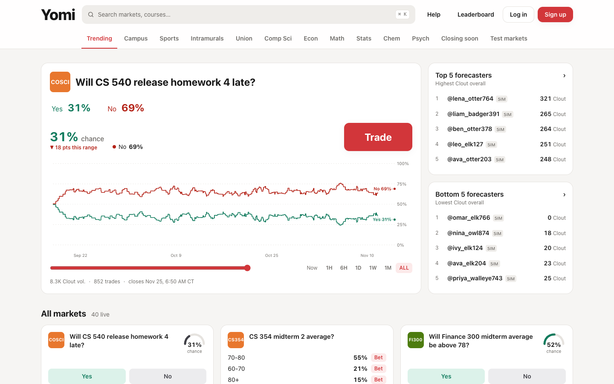
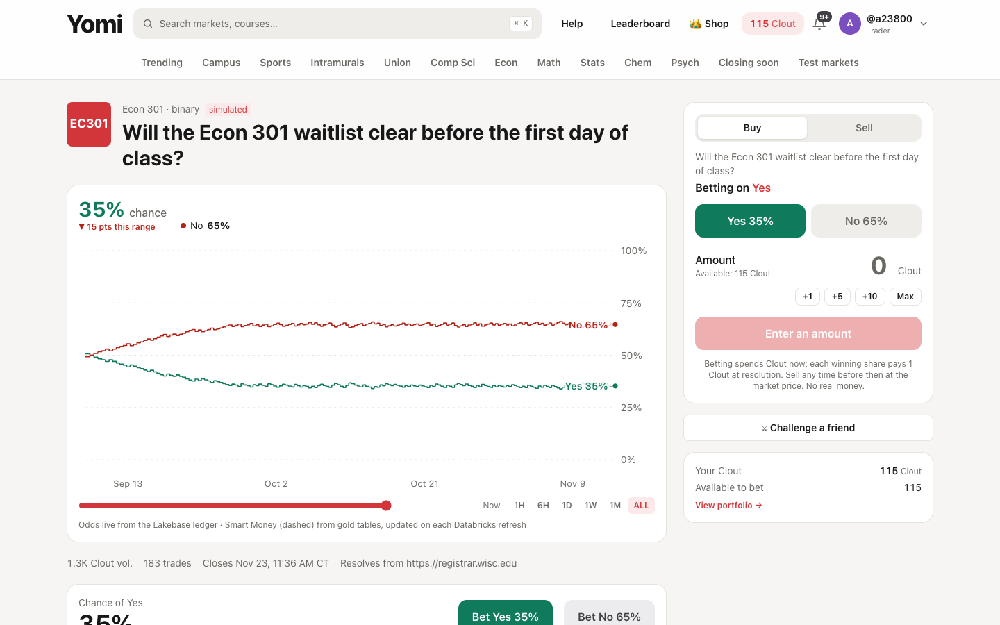
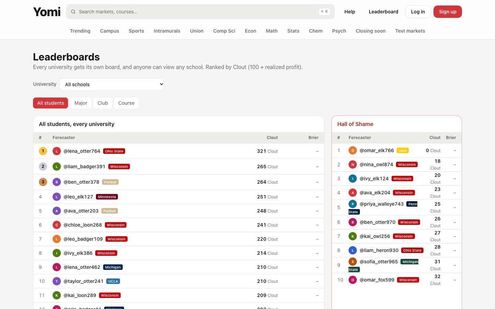
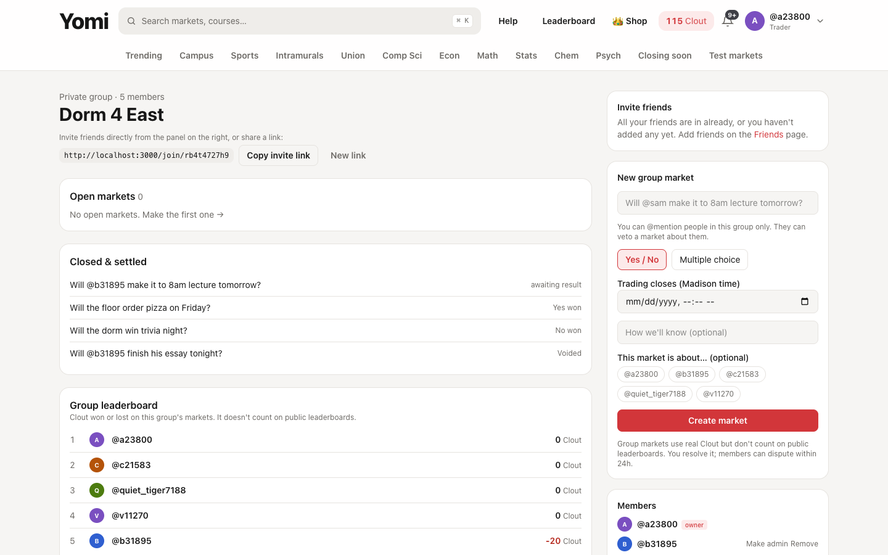
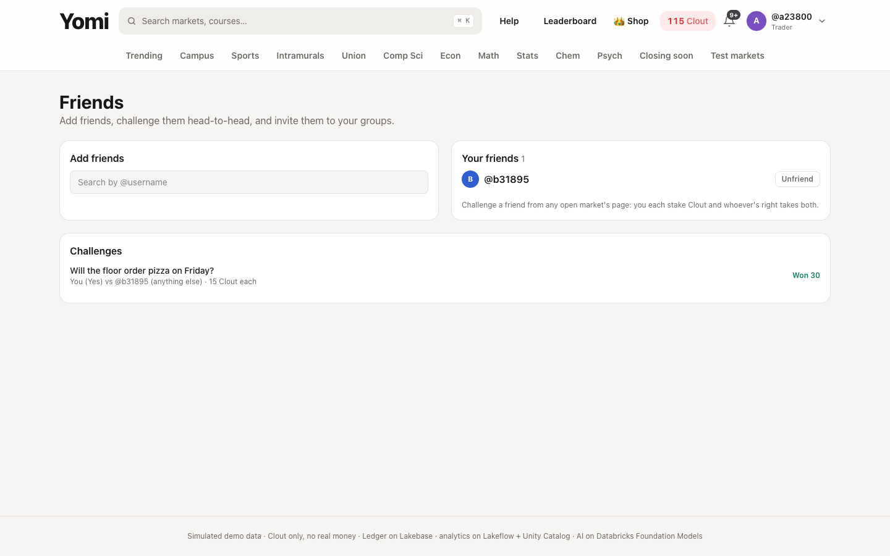
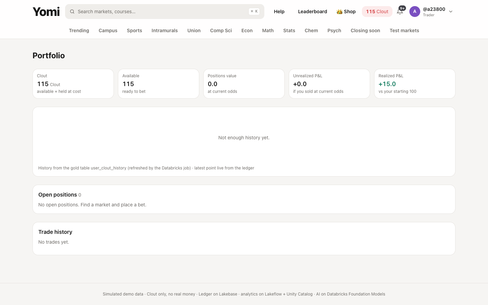
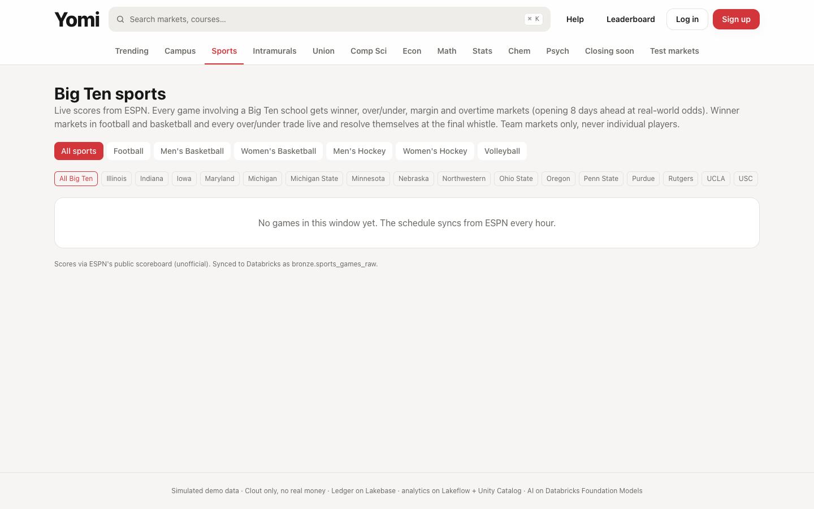

# Yomi

**Bet your Clout, not your cash.**

Yomi is a prediction market for college students. You stake your reputation (**Clout**) on things students actually care about: whether the midterm gets curved, whether the waitlist clears, whether the Badgers cover the spread, how packed the Nick will be at 6pm. It started at UW–Madison and is open to students at any university.

Clout can't be bought or cashed out, so it isn't gambling. It measures one thing: **how often you're right**.

Built in 24 hours at **MadHacks 2026** for the **Databricks track**. The whole backend runs on Databricks: the trade ledger, the data pipelines, the AI analyst and the hosting.



---

## Contents

- [Why Yomi](#why-yomi)
- [Screenshots](#screenshots)
- [Features](#features)
- [How Yomi uses Databricks](#how-yomi-uses-databricks)
- [How Yomi helps professors](#how-yomi-helps-professors)
- [Deliverables: what each group gets](#deliverables-what-each-group-gets)
- [Run it yourself](#run-it-yourself)
- [Repo layout](#repo-layout)
- [Team](#team)

---

## Why Yomi

Students already guess about everything: the curve, the waitlist, the exam average. That knowledge is spread across group chats and Reddit threads and lost a week later. Yomi turns those guesses into **prices**:

- **Students** get a live, crowd-sourced answer, and a public record of how good their own judgment is.
- **Professors** get an early, anonymous signal of where a class is confused or anxious, before the exam rather than after it.
- **Campus partners** like the Wisconsin Union get a crowd forecast of demand they can compare with their own data.

---

## Screenshots

> Screenshots come from a local run with simulated demo data. Every simulated user and market is labeled **SIM** in the app.

| | |
|---|---|
| **Market page:** live odds chart with a time scrubber, buy/sell panel, challenge a friend<br> | **Leaderboards:** by university, major, club and course, plus the Hall of Shame<br> |
| **Private groups:** group markets about members, invites, group leaderboard<br> | **Friends and head-to-head challenges**<br> |
| **Portfolio:** Clout, available balance, positions, unrealized and realized P&L<br> | **Big Ten sports:** markets for every game, opened at real-world odds<br> |

---

## Features

### Trading
- **Markets with a market maker.** Every market is priced by an **LMSR automated market maker** (logarithmic market scoring rule), so there's always someone to trade with and the odds are always a real probability. Small bets barely move the price; big conviction moves it a lot.
- **Market types:** yes/no, multiple choice, and numeric ranges (for example "Exam 3 average: below 65 / 65–72 / 72–80 / above 80").
- **Buy and sell any time** before close, in whole Clout. Selling uses average cost, so realized and unrealized P&L are exact.
- **Kalshi-style odds chart** with a scrubber and 1H / 6H / 1D / 1W / 1M / ALL ranges, plus a dashed **Smart Money line** (see below).
- **Portfolio:** Clout over time, open positions at current odds, unrealized and realized P&L, full trade history.
- **Comments** on every market (scrollable, paginated) and a "who actually bet" view of real trades. A **"Real people only"** toggle hides simulated traders.

### Clout and reputation
- Everyone starts with **100 Clout**. Clout = 100 + realized profit. You can never bet more than you have, and you can never buy more.
- **Leaderboards** for every university and for all students combined, filterable by major, club and course, plus a **Hall of Shame** for the bottom of the board. They're computed live from the ledger with a plain SQL sort, so they cost no extra compute.
- **Calibration and Brier score** on every profile ("when you say 70%, you're right 71% of the time").
- **Smart Money:** a second price per market that weights only traders who have actually made Clout. When the crowd and the Smart Money disagree, that's interesting.
- **Titles and flair** you earn (for example "Oracle of Econ 301"), **profile pictures**, and a **Shop** of cosmetics unlocked by Clout.

### Market categories
- **Courses:** CS, Econ, Math, Stats, Chem, Psych and more. Waitlists, curves, exam averages, deadline extensions.
- **Campus:** library hours, Lake Mendota freezing over, first snowfall, dining hours, ASM referendums.
- **Weather and rec-center markets that settle themselves** from Open-Meteo and the UW Rec Well live crowd counts.
- **Big Ten sports:** markets for every Big Ten football, basketball, hockey and volleyball game, covering the winner, over/under, margin and overtime. They open at **real-world odds** from ESPN's matchup predictor, trade live during football and basketball games, and **settle automatically at the final whistle**. Team markets only, never individual players.
- **Intramurals:** captains report the score, the other captain confirms, and the market settles.
- **Wisconsin Union:** "Will the Sett be 80% full at 7pm?", "Will the Strada wait hit 6 minutes at noon?". Opened daily near 50/50 from historical baselines and settled from venue data (a partner API, sensors or a labeled simulated feed).
- **Test markets** that resolve on their own, for demos and onboarding.

### Friends, groups and challenges
- **Friends:** mutual friend requests and search by @username.
- **Private groups:** create a group and invite friends **inside the app** (they get a notification and tap Join) or with an invite link. Owners and admins manage members.
- **Group markets** are visible to members only. They're the one place a market can be about a person ("Will @sam make 8am lecture?"), and only members of that group can be tagged. **Anyone tagged can veto** a market about them, which voids it and refunds everyone.
- **Fair resolution:** the creator resolves, and any member can **dispute within 24 hours**. Members who didn't trade the market vote, and a changed result re-settles everyone's Clout.
- **Head-to-head challenges:** stake Clout against a friend on any market you can both see. The winner takes both stakes.
- **Notifications** for friend requests, invites, tags, mentions, vetoes, disputes, votes and challenges.
- Group markets and challenges use real Clout but **don't count on public leaderboards**, so nobody can farm rank with friends.

### AI market analyst
- Every market has an **AI analyst panel**: a summary, why the price moved, crowd versus Smart Money, comment sentiment, and a mispricing flag.
- **Ask the AI:** a live chat about a market, grounded in fresh prices and comments.
- Guardrails: the analyst never tells anyone what to bet and never discusses individual students. Questions are rate-limited.

### Admin and safety
- Admins can create markets, resolve them, **override** an automatic result, and seed markets.
- Instructors and TAs **can't trade on their own course's markets**: they're listed in a `course_staff` table and their trades are rejected.
- No markets about individual students, except inside private groups where the tagged person has a veto.
- Passwordless sign-in with a university email: one account per email, and only a SHA-256 hash of each token is stored.
- Rate limits on trades, sign-in links and AI questions. All demo data is labeled as simulated.

---

## How Yomi uses Databricks

Databricks is the backend, not an add-on. Every layer runs on it:

```
 ┌──────────────── Next.js app on Databricks Apps ────────────────┐
 │ trading, auth, groups              live AI chat (Foundation    │
 │ (writes)                           Model API)                  │
 └──────┬────────────────────────────────────────▲────────────────┘
        ▼                                        │ reads gold via SQL warehouse
 ┌──────────────────────┐   Lakeflow Job   ┌─────┴───────────────────────────┐
 │ Lakebase (Postgres)  │ ───────────────► │ Unity Catalog: the_curve        │
 │ live trade ledger    │  sync to bronze  │ bronze → silver → gold          │
 │ (the_curve_ledger)   │                  │ Lakeflow Declarative Pipelines  │
 └──────────────────────┘                  │ ai_query + MLflow traces        │
                                           │ Delta Sharing → partners        │
                                           └─────────────────────────────────┘
```

| Databricks product | What Yomi does with it |
|---|---|
| **Lakebase** (managed Postgres) | The **live trade ledger**: users, markets, outcomes, every trade, comments, groups, challenges, notifications. Trades are ACID transactions with row locks, so balances can never go negative from a race. Auth uses short-lived Databricks OAuth credentials, with no database passwords. It's registered in Unity Catalog as `the_curve_ledger`, so Spark and SQL can read it directly. |
| **Unity Catalog** | Catalog `the_curve` with a **medallion architecture**: `bronze` (raw copies of ledger tables, ESPN games, weather, rec counts, venue metrics), `silver` (cleaned and joined trades with post-trade prices) and `gold` (analytics the app reads). |
| **Lakeflow Jobs** (serverless) | `yomi-refresh` syncs the ledger into bronze (incremental MERGE of new trades only) and rebuilds the pipeline. `yomi-ai-insights` runs the batch AI analyst. Separate jobs handle the Union markets, campus weather and the initial simulation. |
| **Lakeflow Declarative Pipelines** | `silver.sql` and `gold.sql` build materialized views: per-user Clout, **Brier score**, **calibration curves**, **Smart Money prices**, market price history, mispricing, flair, Clout history for portfolio charts, and **sports accuracy** (crowd closing price versus result). A separate, isolated pipeline (`union.sql`, `campus.sql`) builds venue baselines, Union forecasts, partner accuracy scorecards and rec-center busyness by weekday and hour. |
| **Databricks SQL warehouse** | The app reads gold tables through the Statement Execution API, with a 30-minute cache so page views don't keep the warehouse awake. |
| **AI Functions (`ai_query`)** | The batch AI analyst builds a context per market (question, crowd versus Smart Money, 24-hour activity, price moves, recent comments) and calls `ai_query` with a **JSON-schema response** that is written to `gold.market_ai_insights`. |
| **Foundation Model APIs** | Live "Ask the AI" chat streams from `databricks-meta-llama-3-3-70b-instruct`. Every question is logged back to Lakebase and synced to bronze. |
| **MLflow** | Every batch analyst call is logged as an **MLflow trace**, so prompts, outputs and latency are auditable. |
| **Databricks Apps** | Hosts the Next.js site as the app `yomi`. The warehouse, model endpoint, Lakebase database, refresh job and secrets are attached as **app resources**, so nothing is hard-coded. |
| **Asset Bundles** | Everything (jobs, pipelines, the app, permissions) is code in `databricks.yml` and `resources/*.yml`. One command deploys the whole stack to a new workspace. |
| **Secret scopes** | Admin emails, partner emails and API keys live in the `the-curve` secret scope, never in this (public) repo. |
| **Delta Sharing** | Gold Union tables (crowd forecasts and accuracy) can be shared directly with campus partners. |

### Built to be cheap

We ran on Databricks Free Edition and learned to watch compute closely. The design keeps spending near zero when nobody is using the app:

- **Leaderboards are a SQL sort on Lakebase**, not a pipeline run, so they're always live and cost nothing extra.
- **Pipeline refreshes are on demand** (`scripts/cloud.sh refresh`) instead of running after every resolution. Schedules ship **paused**.
- **AI insights run as their own manual job**, capped to the top 20 markets and skipped if they ran in the last 2 hours.
- **Gold reads are cached** for 30 minutes, and background pollers run every 5 minutes.
- `scripts/cloud.sh up | down | status` turns the app and database on or off in one command.
- **Local mode:** set `DATABASE_URL` to any Postgres and the whole app runs on a laptop with zero Databricks usage.

---

## How Yomi helps professors

Professors usually find out a class is lost **after** the exam. Yomi markets surface that signal **before** it.

- **Early warning on confusion.** If students price "Will the CS 300 midterm 2 average be above 75%?" at 30%, the class expects to struggle. If "Will the project deadline get extended?" climbs to 70%, students are behind. These are aggregate, anonymous prices, so they reflect what students actually believe, not what they'll say in office hours.
- **Course-level trends** come from the gold tables: price history per course market, comment sentiment from the AI analyst, and which topics draw the most activity.
- **Fair by design.** Instructors and TAs are listed in `course_staff` and **can't trade their own course's markets**, so nobody can profit from inside information. Markets are about the course, never about individual students.
- **A low-stakes way to practice probabilistic thinking.** Calibration and Brier scores show students how well they reason under uncertainty. That's a skill in its own right, and a natural fit for stats, econ and data science courses.
- **No extra work.** Students create and trade the markets. The instructor just reads the results.

---

## Deliverables: what each group gets

How Yomi gets its output into people's hands:

| Who | What they get | How it's delivered |
|---|---|---|
| **Students** | Live odds on what matters to them, a public calibration record, leaderboards, groups and challenges with friends | The web app (on Databricks Apps today; a public host next), in-app notifications, sign-in with a university email |
| **Professors** | A **weekly course digest**: the markets on their course, where the odds moved, what students are worried about (an AI summary of comments) and how accurate the crowd has been | *Planned:* a scheduled Lakeflow Job runs `ai_query` over the gold tables for each course and emails the digest, with an instructor view in the app. Every summary is logged as an MLflow trace. The data already exists in gold today. |
| **Campus partners** (Wisconsin Union, Rec Well) | Crowd forecasts of demand ("how busy will the Sett be at 7pm?") and a scorecard of how accurate the crowd is compared with their own historical baseline | A **partner dashboard** (`/partners`), a **partner REST API** (`POST /api/partner/metrics` to push data, `GET /api/partner/forecasts` to pull forecasts; per-partner hashed API keys) and **Delta Sharing** of the gold Union tables |
| **Universities and researchers** | Anonymous, aggregate data on how student expectations form and how accurate crowds are | Gold tables in Unity Catalog, shareable with Delta Sharing; Genie or AI/BI dashboards on top |
| **Developers and judges** | The full source, one-command deploy, a local mode | This repo: `databricks bundle deploy` for the cloud, `npm run dev` with `DATABASE_URL` for local |

---

## Run it yourself

### Local (no Databricks needed)

```bash
# 1. Any Postgres works. This applies the schema and loads ~2,000 simulated users, 50 markets and ~19k trades:
pip install psycopg
python3 scripts/seed_local.py postgresql://postgres@localhost:5433/yomi

# 2. Point the app at it and run
cd app
npm install
echo "DATABASE_URL=postgresql://postgres@localhost:5433/yomi" > .env.local
npm run dev    # http://localhost:3000
```

In local dev the sign-in link is shown on screen (demo mode), so you can sign in with any university email.

### On Databricks

```bash
databricks auth login --host https://<your-workspace>.cloud.databricks.com
databricks bundle deploy        # jobs, pipelines, app config
databricks bundle run yomi      # build and start the website
scripts/cloud.sh status         # what's running
scripts/cloud.sh down           # stop the app and database when you're done
```

Put admin emails in the secret scope, not in the repo:

```bash
databricks secrets put-secret the-curve admin_emails --string-value "you@school.edu"
```

### Tests

```bash
cd app && npm test                                    # LMSR, Clout, scoring, social, sports rules
cd databricks/lib && python3 -m unittest test_clout   # Python mirror, same test vectors
```

The TypeScript core and its Python mirror test against the same fixtures (`lib/test-vectors.json`), so the app, the jobs and the gold SQL can't drift apart.

---

## Repo layout

```
app/                  Next.js 16 + Tailwind app (deployed as a Databricks App)
  src/core/           LMSR, Clout, scoring, sports and social rules (+ tests)
  src/server/         Lakebase ledger, markets, social, leaderboards, AI analyst, pollers
  src/app/            Pages and REST API routes
databricks/
  notebooks/          simulate, seed, sync to bronze, weather, AI analyst batch, Union jobs
  pipelines/          silver.sql, gold.sql, union.sql, campus.sql (Lakeflow)
  lib/                Python mirror of the core math + tests
db/schema.sql         Lakebase ledger schema (idempotent)
resources/            Asset Bundle jobs, pipelines and app
scripts/              cloud.sh / cloud.ps1, seed_local.py, SQL helpers
docs/screenshots/     Images used in this README
```

---

## Team

Built at MadHacks 2026 by Rishon Singh, Musa Rahman, Fayzaan Virk and Ben Panackal.

No real money is involved anywhere. All demo data is simulated and labeled as such. MIT licensed.
